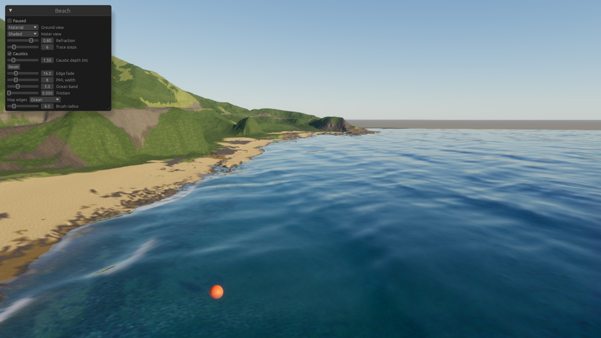
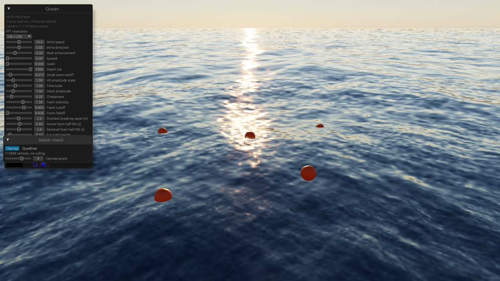
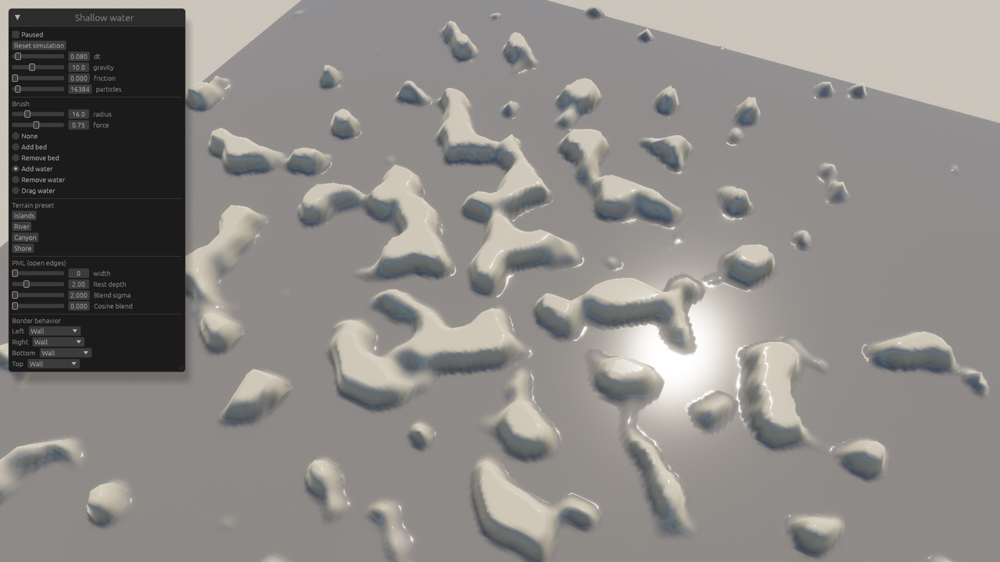
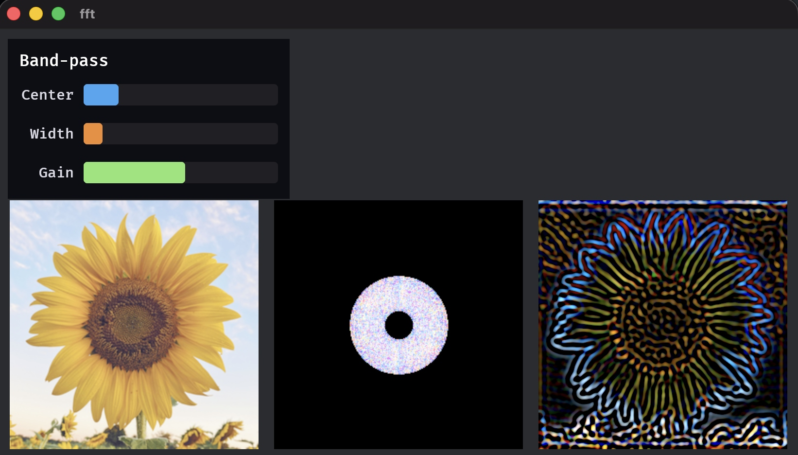

# bevy_fft

GPU FFT and real-time water simulation for [Bevy](https://bevyengine.org).

bevy_fft runs 2D Fast Fourier Transforms in compute shaders on Bevy's render graph. On top of that it builds an FFT ocean, shallow water and dispersive wave solvers, and one water surface that draws all of them together.



## Features

- **GPU FFT.** Forward and inverse 2D FFTs on square power-of-two grids up to 4096 × 4096, with a hook for your own compute pass on the spectrum between them.
- **FFT ocean.** Tessendorf-style ocean cascades with finite-depth dispersion, TMA spectra, swell, choppy horizontal displacement and whitecap foam.
- **Shallow water.** A staggered-grid solver on the GPU, with a terrain bed, wetting and drying, ocean-forced open borders and absorbing edges.
- **Dispersive waves.** Bulk shallow water combined with Airy surface waves (Jeschke and Wojtan), for boat wakes and ripples.
- **eWave.** Tessendorf's iWave evolved in Fourier space on a periodic grid.
- **Shared water surface.** Every solver writes into the same camera-centred LOD textures, so one material draws them all and they blend at their edges. The mesh is a GPU-selected quadtree or a clipmap.
- **Water optics.** Terrain-aware transmission and refraction, screen-space reflection, caustics, foam that advects with the flow, an underwater view and the waterline.
- **Breaking fronts.** Breaking wave fronts in shallow water traced as tracked lines along the crest (Thuerey et al. 2007), for spray, foam and breakers to follow.
- **Queries.** Read the water height and velocity back on the CPU, for buoys and floating objects.

## Gallery

|  |  |  |
|---|---|---|
| `ocean`: FFT ocean cascades with buoys | `shallow_water`: the staggered solver around islands | `fft`: a radial band-pass in the frequency domain |

## Getting started

bevy_fft targets **Bevy 0.20** and Rust **1.97.1** or newer. The water modules aren't on crates.io yet, so depend on the repository until the next release:

```toml
[dependencies]
bevy_fft = { git = "https://github.com/mate-h/bevy_fft" }
```

Add `FftPlugin` before any plugin built on it. Their `finish` steps need the FFT's render resources, and the app panics at startup if the order is reversed.

```rust
use bevy::prelude::*;
use bevy_fft::prelude::*;

fn main() {
    App::new()
        .add_plugins((DefaultPlugins, FftPlugin, OceanPlugin))
        .run();
}
```

The examples are the best starting point for each feature. `bevy_fft::prelude` exports what they use, and `cargo doc --open` builds the API docs.

## Examples

| Example | What it shows | Run |
|---|---|---|
| `fft` | Forward FFT, a band-pass on the spectrum, and inverse FFT on an image | `cargo run --example fft` |
| `ocean` | FFT ocean cascades, with a quadtree or clipmap surface | `cargo run --example ocean --features free_camera` |
| `shallow_water` | The shallow water solver with a brush on a PBR plane | `cargo run --example shallow_water --features free_camera` |
| `dispersive` | Dispersive waves on their own, with mouse-drawn wakes | `cargo run --example dispersive --features free_camera` |
| `wake` | A dispersive patch on the FFT ocean, with a scripted boat | `cargo run --example wake --features free_camera` |
| `ewave` | A periodic eWave height field | `cargo run --example ewave --features free_camera` |
| `beach` | Surf over real terrain: the ocean, a shallow water grid and terrain-aware optics | `cargo run --release --example beach --features free_camera` |

Add the `file_watcher` feature to hot-reload shaders while you edit them.

### The beach example

The beach puts a shallow water grid over a 2 km square of the Lumahaʻi shoreline on Kauai, with ground from 1 m LiDAR drawn by [bevy_terrain](https://github.com/mate-h/bevy_terrain). The terrain tiles and texture arrays are generated locally and kept out of git:

```bash
python3 tools/prepare_beach_materials.py --bake-terrain
```

The script needs NumPy and GDAL, the Hawaii topobathy dataset in `~/Downloads/hawaii_topobathy`, and the bevy_terrain processor built in a neighboring checkout. The [material notes](assets/examples/beach_materials.md) describe the texture sources, their real-world scale and the sand wetness.

These environment variables change the beach:

| Variable | Effect |
|---|---|
| `BEACH_CELL_SIZE` | Solver cell size in meters, 2 by default. `1` matches the terrain data, at about a third more GPU time per frame. |
| `BEACH_TRACE_STEPS` | Steps in the water's screen-space traces, 6 by default. The panel has a slider too. |
| `BEACH_CAMERA` | Start camera as `x,y,z,tx,ty,tz`: position, then target. |
| `BEACH_FRONTS` | Draw the traced breaking fronts from the start. The panel toggles them too. |

To bake another bay or river, [`tools/bake_topobathy.py`](tools/bake_topobathy.py) fetches heights from Esri TopoBathy, carves river channels along splines, and writes terrain tiles and a sea-floor depth texture. It needs an ArcGIS API key in `ARCGIS_API_KEY`.

## Modules

| Module | Contents |
|---|---|
| [`fft`](src/fft/mod.rs) | `FftPlugin`, `FftSource`, `FftSchedule` and the render graph passes |
| [`ocean`](src/ocean/mod.rs) | `OceanPlugin`, ocean cascades and spectra, clipmaps and `OceanQueries` |
| [`water`](src/water/mod.rs) | The shared LOD data, `WaterSurfaceMaterial`, `WaterQuadtree`, foam, caustics, transmission and the underwater view |
| [`shallow_water`](src/shallow_water/mod.rs) | The staggered shallow water solver |
| [`dispersive`](src/dispersive/mod.rs) | Hybrid shallow water and Airy waves |
| [`ewave`](src/ewave/mod.rs) | eWave in Fourier space |
| [`complex`](src/complex/mod.rs) | Complex number helpers for WESL shaders |

Don't add `EwavePlugin` and `DispersivePlugin` to the same app: both insert their passes right after the FFT resolve.

## Using the FFT

Spawn an `FftSource` and choose how much runs each frame with `FftSchedule`:

- `Forward` transforms spatial buffer A into spectrum buffer C and stops.
- `Inverse` assumes C is already filled and transforms it into spatial buffer B.
- `ForwardThenInverse` runs both, so you can edit C on the GPU between them.

`FftSource::square_forward_then_inverse(n)` and `FftSource::square_inverse_only(n)` set up the common cases. After the graph runs, `FftTextures::spatial_output` holds the spatial result and `FftTextures::power_spectrum` a displayable spectrum. `FftInputTexture` uploads an image from the CPU, and `FftInputDomain` picks whether it lands in A or C.

### Editing the spectrum

Each frame the passes run in this order on Bevy's root render graph schedule, before `camera_driver`:

`run_fft_forward` → spectrum slot → `run_fft_resolve_spectrum` → `run_fft_inverse` → `run_fft_resolve_outputs`

The spectrum slot passes C through unchanged until you replace it. In your plugin's `finish`, call `disable_spectrum_passthrough`, then add your compute system on the same schedule with `.after(FftNode::ComputeFFT).before(FftNode::ResolveSpectrum)`. Use `FftBindGroupLayouts::common` so your bindings match the FFT passes. The `fft` example's band-pass shows the pattern.

### Frequency layout

The FFT puts the zero frequency at index `(0, 0)`, with positive frequencies first and negative ones wrapped to the end of each axis. A per-texel multiply in frequency space must map each `(i, j)` to `(k_x, k_y)` in that same order. A centred `2π (i - N/2) / L` grid matches only if you shift the spectrum, which the ocean does when it writes C. A mismatched `k` shows up as a lattice pattern over the result.

### Limits

- Grids are square, with a power-of-two side.
- The twiddle table covers sides up to 4096. Your GPU's maximum texture size also applies, commonly 8192 or 16384.
- Buffers are `Rgba32Float` real and imaginary textures. The [`c32`](src/complex/c32.wesl) helpers can pack a complex number into two f16 values, but the FFT passes use float storage only.
- All `FftSource` entities share one twiddle table, so every active transform must use the same layout.

## Documentation

- [Water rendering](docs/water_rendering.md): transmission over coastal terrain and how to set it up.
- [Shallow water](docs/shallow_water.md): the solver, its borders and its coupling to the ocean.
- [Dispersive waves](docs/dispersive.md): the hybrid split and the NumPy reference.
- [Roadmap](ROADMAP.md): planned and research directions.
- [Changelog](CHANGELOG.md)

## License

MIT. See [LICENSE-MIT](LICENSE-MIT).
